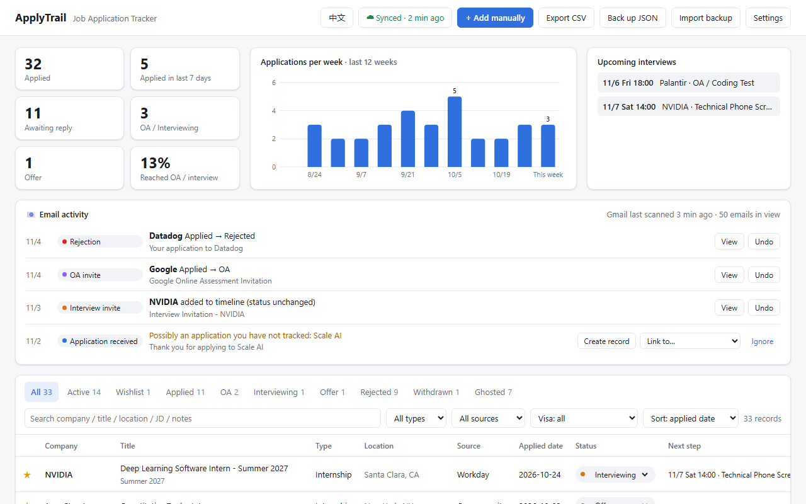

# ApplyTrail – Job Application Tracker

[中文说明](README.zh-CN.md) · [Website](https://jiahao-xie-86.github.io/applytrail/) · [Privacy policy](https://jiahao-xie-86.github.io/applytrail/privacy.html)

A Chrome extension (also works in Edge) that keeps track of your internship and full-time job applications. It records each application with its full job description, updates statuses from recruiting emails in Gmail, keeps interview notes, and syncs between your computers through your own Google Drive. There is no developer server: your data stays in your browser and your own Drive. The interface is available in English and Chinese.

## Install

**Chrome Web Store:** coming soon (in review).

**From source** (works now):

1. Download this repository ([zip](https://github.com/Jiahao-Xie-86/applytrail/archive/refs/heads/main.zip)) and unzip it.
2. Open `chrome://extensions` (Edge: `edge://extensions`) and turn on **Developer mode**.
3. Click **Load unpacked** and select the folder that contains `manifest.json`.
4. Pin ApplyTrail to the toolbar. The tracker opens after installing.

Pages that were already open before installing need a refresh before automatic recording works there.

## Three ways to record an application

| | |
|---|---|
| **Automatic** | After you submit on Greenhouse, Lever, Workday, Ashby, LinkedIn Easy Apply, Indeed and similar sites, the "Thank you for applying / Your application has been submitted" page is detected and the application is saved as *Applied*. A notice appears in the corner, with **Undo** and **Edit**. |
| **One click** | On any job posting, click the toolbar icon (or press `Alt+Shift+J`). Company, title, location, salary, visa sponsorship and the JD are filled in; check and save. You can also save it as *Wishlist*. |
| **Manual** | **+ Add manually** in the tracker. |

If the JD is not picked up, select the JD text on the page and then click the icon. The selection is used as the JD.

Confirmation pages rarely include the JD, so automatic recording fills in details from the posting you viewed last in the same tab (or in the LinkedIn tab that opened the application).

## Recruiting emails (Gmail)

While Gmail is open on the web (mail.google.com), ApplyTrail reads the sender, subject and preview of emails in the list, and the body of an email you open, and updates the matching application:

| Recognized as | Examples | Status |
|---|---|---|
| Online assessment | HackerRank, CodeSignal, "online assessment" | → OA |
| Interview invitation | "schedule a phone interview", Calendly links, Superday | → Interviewing |
| Rejection | "Unfortunately… move forward with other candidates" | → Rejected |
| Offer | "pleased to extend an offer" | → Offer |
| Application received | "Thank you for applying", LinkedIn "application was sent" | Wishlist → Applied |

- A notice in Gmail lets you undo. **📧 Email activity** in the tracker lists every result with a link back to the email.
- Emails are matched by sender domain, sender name (for emails sent through Greenhouse and other ATSs) and company names in the email. If one company has several applications, the job title in the email decides; if it is still unclear, you pick.
- An application confirmation with no matching record shows up as "possibly an application you have not tracked", with one-click **Create record**. This is a quick way to backfill applications from before you installed (last 60 days).
- Statuses never move backward, and emails older than the application date are ignored.
- Some rejections only show the reason inside the email: open it and it is picked up.
- Only recruiting emails are processed. Email bodies are not stored; only the subject, sender, type and the sentence that matched.
- Gmail on the web only (not Outlook or the mobile app). Can be turned off in Settings.

## The tracker

- **Overview:** applied, last 7 days, awaiting reply, OA / interviewing, offers, share that reached OA / interview; weekly chart; upcoming interviews.
- **List:** tabs by status, full-text search (company, title, JD, notes), filters by type, source and visa; "no reply in N days" after 3 weeks.
- **Details** (click a row):
  - *Info*: every field is editable and saved automatically.
  - *Interviews*: each round's type, time, interviewer, meeting link, notes and result; export to your calendar (`.ics`, 30-minute reminder). Adding a round moves the status to OA / Interviewing.
  - *Prep*: experience, degree and graduation requirements from the JD, skill keywords, the visa sentence; links to Glassdoor, LeetCode company questions, 1Point3Acres, Levels.fyi, H-1B records, Blind and LinkedIn; prep notes; **Copy AI interview-prep prompt** (includes the JD and your notes, ready to paste into Claude or another assistant).
  - *JD*: the saved description with skill keywords highlighted, still available after the posting is taken down.
  - *Timeline*: status changes, interviews and your own notes.
- **Language:** the **EN / 中文** button at the top switches the interface; Settings also has *Same as browser*.

## Supported sites

| Site | Status |
|---|---|
| Greenhouse, Lever, Ashby, Workday, Amazon Jobs | Tested on live postings |
| Indeed | Adapted to the 2026 layout |
| LinkedIn, Glassdoor, Handshake, SmartRecruiters | Site-specific rules, not yet verified on live pages (these sites require sign-in) |
| Other career sites and ATSs (iCIMS, Jobvite, Workable, Oracle, SuccessFactors…) | Generic rules: schema.org JobPosting data, page title, and sections such as "Qualifications" / "Responsibilities" |

Sites change their layout from time to time. Every field can be corrected in the popup. Reports are welcome in [Issues](https://github.com/Jiahao-Xie-86/applytrail/issues).

## Sync with Google

Click **☁ Sign in to sync** in the tracker and choose your Google account. Every computer signed in to the same account stays in sync (Chrome and Edge).

- Data is saved as one compressed file in the **hidden app data folder of your own Google Drive**. It does not appear in your Drive file list, and only ApplyTrail can access it.
- Changes upload about 10 seconds after you make them. Other computers pull every 5 minutes, at browser start and when the tracker opens. **Sync now** is in Settings.
- Records are merged one by one: the newer edit wins, and edits to different records on different computers are all kept. Signing in on a new computer merges what is already there.
- Deletions sync too (a deleted record does not come back from another computer). *Delete all data* also clears the cloud copy.
- When Google asks which permissions to allow, keep Google Drive ticked, otherwise sync cannot work.
- **Sign out** affects only the current computer. To remove access completely, visit <https://myaccount.google.com/permissions>.

## Data and backups

- Without sync, **uninstalling the extension deletes your data**. Use **Back up JSON** (full backup; restore with **Import backup**) or **Export CSV** (Excel / Google Sheets).
- Without sync, the tracker reminds you to back up when you have 5+ records and no backup in 14 days.
- Automatic recording and email recognition can be turned off in Settings.

## Privacy

ApplyTrail has no server and no analytics. It reads job postings you visit and recruiting emails in Gmail on the web, inside your browser, and stores your records in your browser and (if you turn on sync) your own Google Drive. Details: [privacy policy](https://jiahao-xie-86.github.io/applytrail/privacy.html).

## Development

See [DEVELOPMENT.md](DEVELOPMENT.md): code layout, adding translations, Google sign-in setup, and releasing to the Chrome Web Store.

## License

[MIT](LICENSE)
