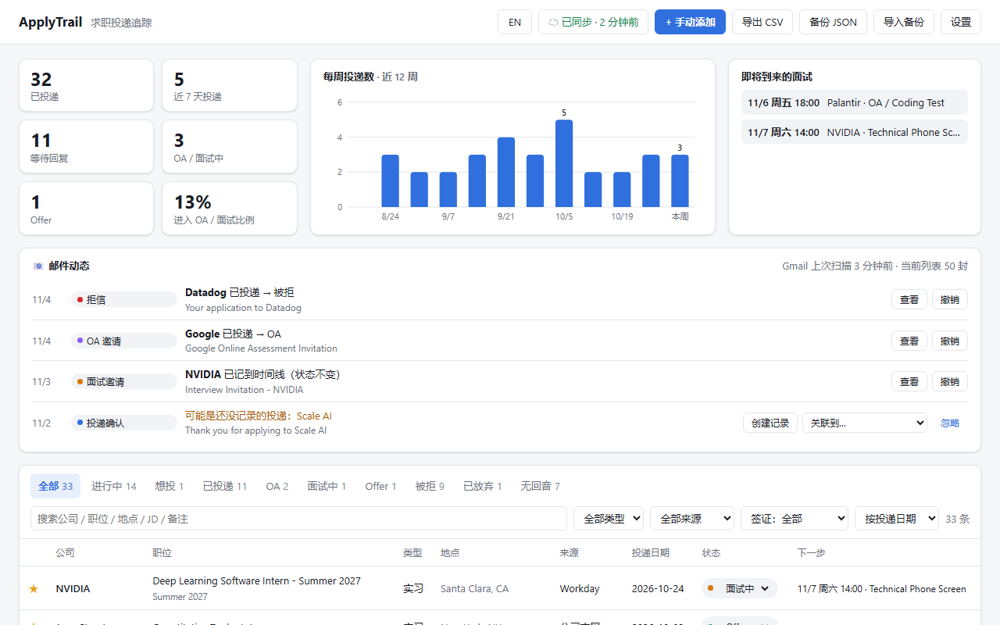

# ApplyTrail – 求职投递追踪

[English](README.md) · [网站](https://jiahao-xie-86.github.io/applytrail/) · [隐私政策](https://jiahao-xie-86.github.io/applytrail/privacy.html#zh)

一个 Chrome 浏览器插件（Edge 也能用），用来记录实习和全职求职的每一次投递：公司、职位、地点、JD 全文、薪资、签证 sponsor 情况、面试轮次和准备笔记；能识别 Gmail 里的 OA、面试邀请、拒信和 Offer 并自动更新状态；可以用 Google 账号在多台电脑之间同步。没有开发者服务器：数据只存在你的浏览器和你自己的 Google Drive 里。界面支持中文和英文。

## 安装

ApplyTrail 从这个仓库安装（没有上架 Chrome 应用商店），Chrome 和 Edge 都能用。

1. [下载 zip](https://github.com/Jiahao-Xie-86/applytrail/archive/refs/heads/main.zip)，解压到一个会一直保留的文件夹。Chrome 从这个文件夹加载插件，所以不要删掉它
2. 打开 `chrome://extensions`（Edge 用 `edge://extensions`），打开右上角 **开发者模式**
3. 点 **加载已解压的扩展程序**，选择里面有 `manifest.json` 的那个文件夹
4. 点浏览器右上角的拼图图标，把 ApplyTrail **固定** 到工具栏。安装后会自动打开追踪表

安装前已经打开的网页，需要刷新一次才会出现 **记录投递** 按钮（点工具栏图标记录不受影响）。

**更新**：重新下载 zip，覆盖同一个文件夹里的文件，然后在 `chrome://extensions` 里点 ApplyTrail 的 ↻，记录都会保留。不要点 **移除**：那会删掉浏览器里保存的记录（开了 Google 同步的除外）。

每份拷贝的插件 ID 都一样（由 `manifest.json` 里的 `"key"` 固定），所以这样安装的每个人都能用 Google 登录同步。

## 三种记录方式

| 方式 | 怎么用 |
|---|---|
| **页面上的按钮** | 在职位页面（Greenhouse / Lever / Workday / Ashby / LinkedIn / Indeed 等）右下角点 **＋ 记录投递**，职位、公司、地点和 JD 一起保存为 “已投递”，弹出的提示里可以 **编辑** 或 **撤销**。提交申请后按钮会变成蓝色（“刚提交了申请？点这里记录”），但不点就不会记录；记录过的职位显示 **✓ 已记录** |
| **一键记录** | 在任何职位页面点工具栏图标（或按 `Alt+Shift+J`），自动抓取信息，确认后保存。也可以先存为 “想投” |
| **手动添加** | 追踪表右上角 “+ 手动添加” |

**Workday、Greenhouse、Lever、Ashby** 上的职位，JD 直接取自这些招聘网站的公开职位接口（也就是招聘页面本身加载的那份数据），和职位原文一字不差，不受页面布局影响；弹窗里会注明来源。自动记录时也一样。其他网站从网页上读取；如果读到的 JD 看起来不完整（太短，或混进了职位列表），弹窗和追踪表会提示。

抓不到 JD 时：在网页上 **选中 JD 文字**，再点图标，会自动用选中的文字作为 JD。追踪表里 **JD → ↻ 重新获取** 可以从职位链接重新读取。

在确认页上记录时，如果确认页本身没有 JD（大多数都没有），会用你在 **同一个标签页**（或打开这个申请页的 LinkedIn 标签页）里最近看过的职位信息补全。

想全自动？**设置 → 记录投递的方式 → 自动记录**：检测到 “Thank you for applying” 页面就直接记录。也可以在设置里隐藏按钮。

## 邮件识别（Gmail）

用 **Gmail 网页版**（mail.google.com）时，插件会读取收件箱列表里的发件人、标题、摘要，以及你打开的那封邮件的正文，识别求职邮件并自动更新对应投递：

| 识别为 | 例子 | 状态变化 |
|---|---|---|
| OA 邀请 | HackerRank / CodeSignal / “online assessment” | → OA |
| 面试邀请 | “schedule a phone interview”、Calendly 链接、Superday | → 面试中 |
| 拒信 | “Unfortunately… move forward with other candidates” | → 被拒 |
| Offer | “pleased to extend an offer” | → Offer |
| 投递确认 | “Thank you for applying”、LinkedIn “application was sent” | 想投 → 已投递 |

- 更新后 Gmail 右下角会提示，可以 **撤销**；追踪表里的 **📧 邮件动态** 会列出每一条识别结果（点标题可回到那封邮件），对应投递的时间线也会记一笔
- 怎么匹配到投递：看发件人域名（如 `@nvidia.com`）、发件人名字（如 “Stripe Recruiting”，适用于 Greenhouse 等代发邮件）和邮件里出现的公司名。同一公司投了多个职位时，会用邮件里的职位名区分；分不清就放到 “邮件动态” 里让你选
- 如果收到确认邮件的职位是你最近 3 周看过、但没被记录下来的，“邮件动态” 里会建议补记，带上那个职位页的职位、JD 和链接，点一下 **创建记录** 即可（开了自动记录时会直接补记，可撤销）
- 匹配时先看发件人和标题；只在正文里提到的公司（如 “Google Meet 会议链接”），在发件人是别的公司时不会被当成投递公司
- 其他没匹配到的投递确认邮件会显示 “可能是还没记录的投递”，一键 **创建记录**，可以用来补录装插件之前的投递（只看最近 60 天的邮件）
- 不会倒退状态：已经在面试中的投递，再收到 OA 邮件不会改回 OA；比投递日期还早的邮件会被忽略
- 列表里只看得到摘要，有些拒信要 **打开那封邮件** 后才能识别
- 只处理求职相关邮件；邮件正文不保存，只记录标题、发件人、识别类型和触发识别的那句话
- 只支持 Gmail 网页版，Outlook / 手机 App 里的邮件不会被识别；可在 “设置” 里关闭

## 追踪表

- **概览**：已投递数、近 7 天投递、等待回复、OA / 面试中、Offer、进入面试比例；每周投递柱状图；即将到来的面试
- **列表**：按状态分栏、全文搜索（公司 / 职位 / JD / 备注）、按类型 / 来源 / 签证筛选；投递 21 天没进展会提示 “N 天无回音”
- **详情**（点任意一行）
  - 信息：所有字段可编辑，自动保存
  - 面试记录：每一轮的类型、时间、面试官、会议链接、复盘笔记、结果；可导出 `.ics` 加到日历（提前 30 分钟提醒）。添加面试会自动把状态改成 OA / 面试中
  - 面试准备：JD 里的年限 / 学历 / 毕业时间要求、技能关键词、签证原文；一键打开 Glassdoor、LeetCode 公司题、一亩三分地面经、Levels.fyi、H1B 记录、Blind、LinkedIn 找 recruiter；准备笔记；“复制 AI 面试准备提示词”（含 JD 和你的笔记，可直接粘贴给 Claude）
  - JD：保存的 JD 全文（职位下线后也能看），技能关键词高亮
  - 时间线：状态变化、面试、自己加的记录（如 “发了 follow-up”）
- **语言**：右上角 **EN / 中文** 按钮切换界面语言；设置里还可以选 “跟随浏览器”

## 支持的网站

| 网站 | 状态 |
|---|---|
| Greenhouse、Lever、Ashby、Workday、Amazon Jobs | 已在真实职位页面上测试抓取 |
| Indeed | 按 2026 新版页面结构适配 |
| LinkedIn、Glassdoor、Handshake、SmartRecruiters | 有专门规则，未在真实页面验证（这些网站需要登录） |
| 其他公司官网 / ATS（iCIMS、Jobvite、Workable、Oracle、SuccessFactors…） | 通用规则：schema.org JobPosting 数据 + 标题 + “Qualifications / Responsibilities” 等段落识别 |

网站改版后抓取可能失效，弹窗里所有字段都可以手动修改。欢迎在 [Issues](https://github.com/Jiahao-Xie-86/applytrail/issues) 反馈。

## 云同步（Google 账号）

追踪表右上角点 **☁ 登录同步** → 用 Google 登录。所有登录同一个 Google 账号的电脑会自动同步，Chrome 和 Edge 都可以。

- 数据存在 **你自己 Google Drive 的隐藏应用文件夹** 里（压缩后的一个文件）：在 Drive 网页里看不到，只有这个插件能读写
- 修改后约 10 秒自动上传；每 5 分钟、打开浏览器、打开追踪表时自动拉取；也可以在设置里点 **立即同步**
- **合并规则**：每条记录各自比较，修改时间较新的那一边为准；两台电脑改了不同的记录，两边的修改都会保留。第一次在新电脑登录时，两边已有的记录会合并
- **删除** 会同步到所有电脑（不会被另一台电脑 “复活”）；“清空全部数据” 也会清空云端
- 登录时 Google 显示权限勾选框的话，要勾上 Google Drive 那一项，否则无法同步
- **退出登录** 只影响这台电脑；要彻底撤销插件的访问，去 <https://myaccount.google.com/permissions>

## 数据与备份

- 没登录同步时，**卸载插件会删除数据**。追踪表右上角 **备份 JSON**（完整备份，可用 “导入备份” 恢复）、**导出 CSV**（用 Excel / Google Sheets 打开）
- 没开同步、记录超过 5 条且 14 天没备份时，追踪表顶部会提醒
- 设置里可以选择记录方式（按钮 / 自动）、隐藏页面按钮、关闭邮件识别

## 开发

见 [DEVELOPMENT.md](DEVELOPMENT.md)（英文）：代码结构、添加翻译、Google 登录配置、发布到 Chrome 应用商店。

## 许可证

[MIT](LICENSE)
